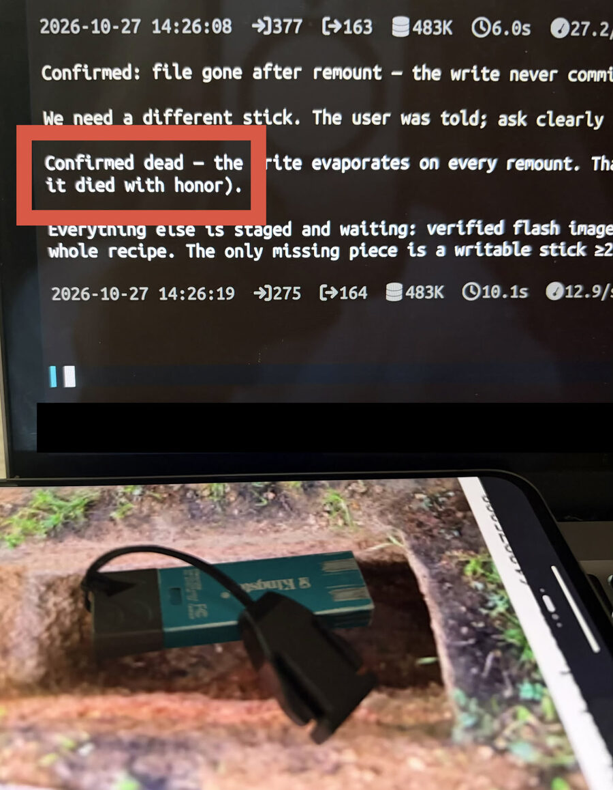

# In memoriam: the USB stick

*The heroic USB stick that died for the first firmware dump.*

During the bootloader dump campaign, mboot's `emmcbin` wrote the projector's
eMMC to a FAT32 stick, partition by partition — MBOOT, OPTEE, DTB, KL,
TVCONFIG, the 500 MB rootfs. Sustained multi-hundred-megabyte writes drove
mboot's `fatwrite` into an endless retry loop, and the stick began returning
`Request Sense 07 27 00` — write-protected sense — its flash exhausted, its
controller done. It never gave up the data it had already written: the first
dump set was recovered intact from its cells, every file size-verified
against the partition table, and that set became the foundation of
everything this repo documents — the rootfs analysis, the symbol maps, the
recovery images, the whole chain.

A sibling stick (and the lesson: dump in ≤64 MB chunks with distinct names)
carried the rest of the campaign, but the first complete set came off this
one. Its write-protected death was transient from the host's point of view —
the same stick "writes fine from macOS" — but it had already given what it
had to give.

Every `.BIN` in the private archive descends from that stick. Remember it
when you run `tools/dump-emmc.sh` — and carry a fresh one.
