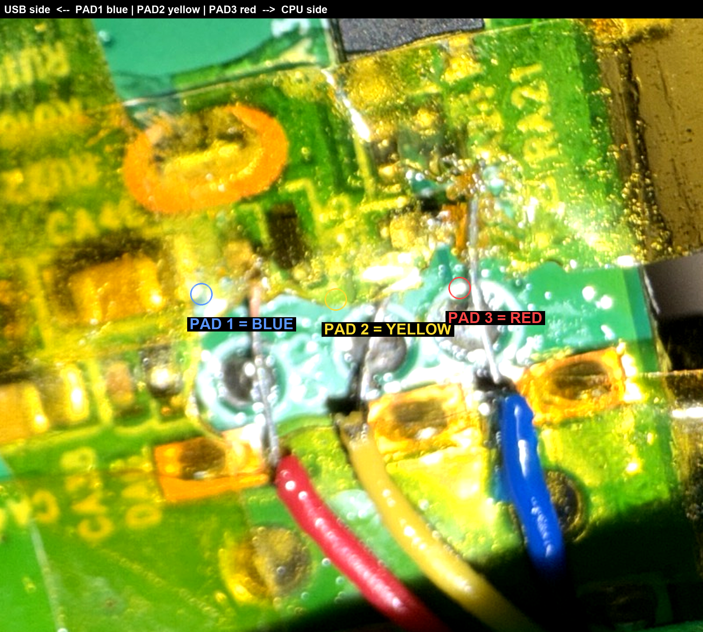

# From stick code-execution to permanent root (TOPTRO X9)

The repo's front door (GitHub Pages page → factory RPC → `executeShell`)
gives you a shell as `factoryservice` (uid 3032). This guide is the rest of
the road: **stock firmware, verified boot intact, root SSH that survives
every reboot** — using the vendor's own boot console. Total hardware cost:
any 3.3 V USB-UART adapter or an ESP32-S3.

Every step below is reversible; recovery is built in (step 7).

## 0. Prerequisites

- The foothold from the README quickstart (page + stick working).
- A UART bridge: the repo's `esp32/x9-uart` firmware on an ESP32-S3, or a
  plain USB-TTL adapter (3.3 V! never 5 V).

## 1. Enable the boot console (no hardware needed yet)

The mboot console is off by default; the factory RPC can switch it on. From
the foothold shell (or add a button yourself in `docs/index.html` — same
call): `mtk.webui.factory.sys.setEmmcEnvVar {"key":"UARTOnOff","val":"on"}`
via `ws://127.0.0.1:7681/mtk.webui.tvCmd?name=FactoryMode`. The setting
persists in the u-boot environment.

## 2. Wire the UART

Inside the case, on the main board: **TX, RX pads next to the USB-side
edge**, GND at the screw hole (H1). Board TX → adapter RX, board RX →
adapter TX, 115200 8N1.



Open the case, connect GND first, keep leads short. Soldering is optional to
start — good pin contact works for a first probe.

## 3. Flash the ESP32 bridge (or skip it with a plain adapter)

`esp32/x9-uart` is a PlatformIO firmware: transparent UART bridge plus
probe/baud/console helpers, with a `bridge`/prompt toggle (Ctrl-]).

```sh
pio run -d esp32/x9-uart -t upload --upload-port /dev/ttyUSB0
```

## 4. Catch the mboot prompt

mboot's autoboot window needs a dense Enter (CR) flood — a human can't do
it; the orchestrator can:

```sh
X9_TTY=/dev/ttyUSB0 python3 tools/boot-orchestrator.py
# "ARMED FOREVER" → power the projector on (mains)
# "PROMPT SECURED" → you are at  << MT5867 >>#
```

## 5. Back up your own firmware FIRST

At the mboot prompt, with a FAT32 stick inserted (`usb start 0` first):

```sh
python3 tools/dump-emmc.sh     # drives mcmd.py → emmcbin → .BIN files on the stick
```

Keep those files offline. They are your unit's exact image — the restore
source for anything that ever goes wrong.

## 6. One-time root shell, then install the payload

Still at the mboot prompt (check `printenv bootargs` first and reuse that
exact string — mboot rewrites bootargs itself):

```
setenv bootargs <original-bootargs> init=/bin/sh
boot                              # do NOT saveenv
```

You land `sh-3.2#` as PID1 on ttyS0 (the UART console must be the ONLY
`console=` — a stray `console=tty0` strands the shell). In that shell, with
the stick re-mounted:

```sh
sh /mnt/usb/sd?1/root-payload/install.sh
```

The installer insmods the USB stack (order matters: `ehci-hcd udc-core
udc-msb250x phy-ms-usb`), mounts the writable data partition, installs
`dst-launcher.sh` + your dropbear + hostkeys generated on the spot, and uses
YOUR `authorized_keys` from the stick. No firmware byte is modified.

Reboot (mains), press POWER on the remote — the standby→wake transition also
brings up wifi — then `ssh -p 2222 root@<projector-ip>`.

Why it persists: the stock `/basic/autorun.sh` executes
`/data/customer/smcast/dst-launcher.sh` from the writable partition at every
boot (vendor behaviour; verified boots pass because the rootfs is untouched).

## 7. Recovery, any time

- mboot prompt: `bin2emmc 0 1 ROOTFS.BIN rootfs` reflashes any partition
  from a stick file (your step-5 backup).
- The `init=/bin/sh` boot is always available as a root shell on any image.
- Full factory reset: restore every `.BIN` from step 5.

## Notes measured on stock firmware

- WiFi (AIC8800D80) powers only on the standby→wake transition: mains cold
  boot = standby; the POWER press is what enables the network. Normal UX is
  unchanged.
- `saveenv` at the mboot prompt persists; `boot` alone does not — keep env
  experiments one-shot.
- emmcbin output files APPEND; use fresh names per run.
- Modified rootfs images do NOT survive cold autoboot (AVB2.0 dm-verity
  reset-loops them). The /data launcher is the verity-compatible persistence.
